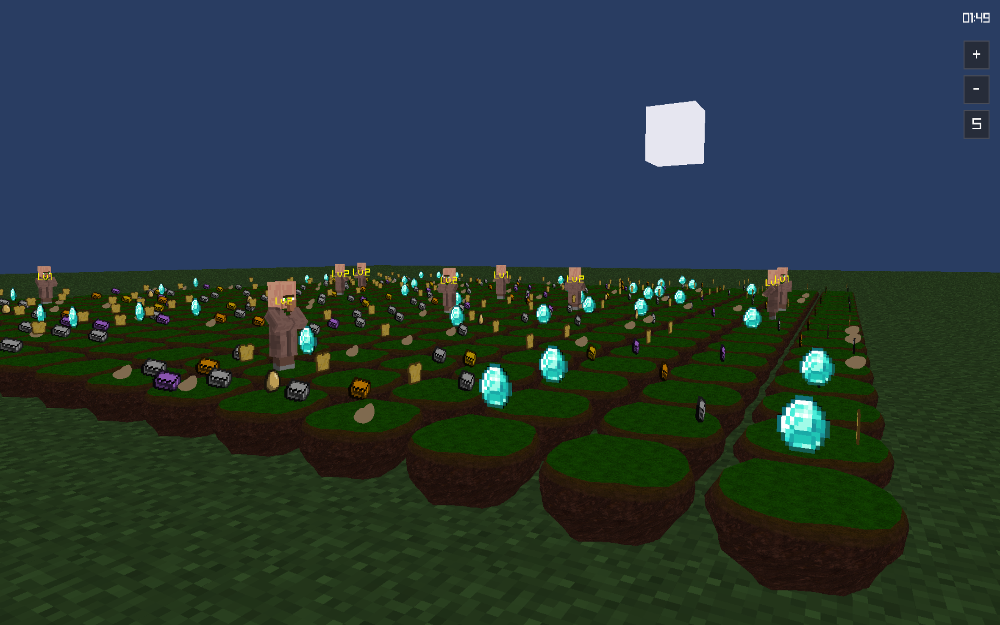
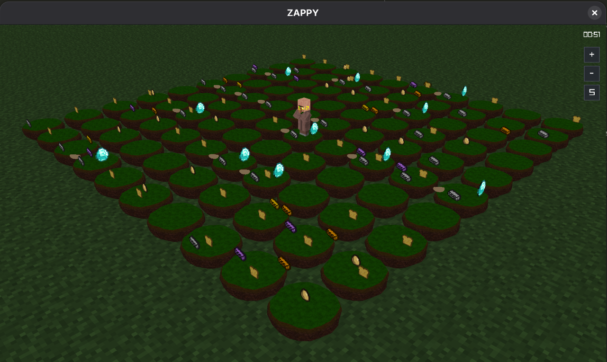

# ZAPPY



### Development

By *Marin Jeunot*(marin.jeunot@epitech.eu), *Evans Ramin*(evans.ramin@epitech.eu), *Thibault Miallet*(thibault.miallet@epitech.eu), *Daniel Lozovan*(daniel.lozovan@epitech.eu), *Nicolas Gonzalez*(nicolas.gonzalez@epitech.eu) & *Sacha Lemée*(sacha.lemee@epitech.eu).

## Objective

- "*The goal of this project is to create a network game where several teams confront each other on a tile map containing resources. The winning team is the first one where at least 6 players reach the maximum elevation.*"

## Features
- `zappy_server`: game server, single-threaded, poll-based socket handling (**C**)
- `zappy_gui`: 2D graphical client (**C++**)
- `zappy_ai`: autonomous AI client (**Python**)

## Getting Started

### Prerequisites

This project requires:
- CMake >= 3.16
- C11 & C++20 toolchain (**Server** & **GUI**)
- Python 3 (**AI**)
- raylib (fetched **automatically** by CMake if not found on the system)

### Installation for Linux

1. **Clone the repository:**

```sh
git clone git@github.com:sachalemee/zappy.git
cd zappy
```

2. **Build the project:**

```sh
cmake -S . -B build
cmake --build build -j
```

Binaries (`zappy_server`, `zappy_gui`, `zappy_ai`) are produced at the repository root.

3. **Run the binaries:**

```sh
./zappy_server -p 4242 -x 10 -y 10 -n team1 team2 -c 3 -f 100
./zappy_gui
./zappy_ai -p 4242 -n team1 -h localhost
```



## Repository Architecture

See the complete repository architecture here : [ZAPPY Project structure](docs/PROJECT_STRUCTURE.md)

## Documentation

- [General documentation](docs/DOCUMENTATION.md)
- [Server](docs/SERVER_DOCUMENTATION.md) · [GUI](docs/GUI_DOCUMENTATION.md) · [AI](docs/AI_DOCUMENTATION.md)

## License

This project is licensed under the **MIT License**.


