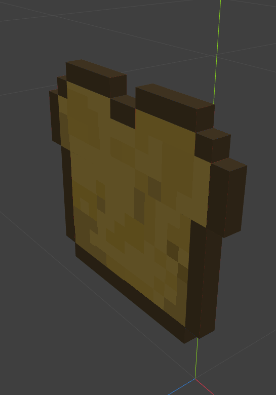
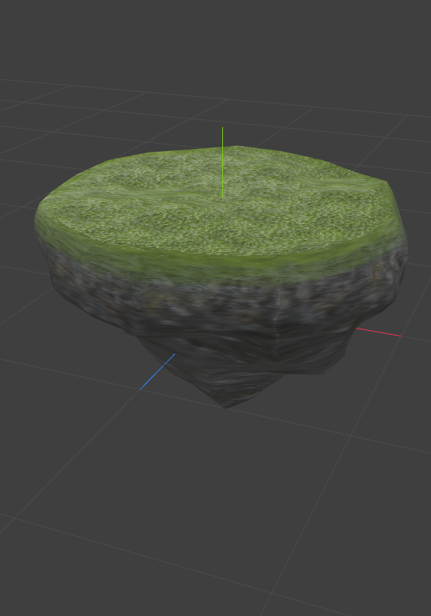
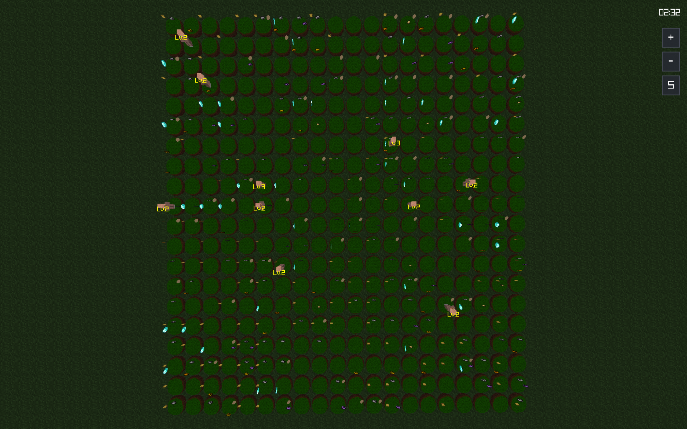

# Comment fonctionne **l'IA** sur notre Zappy ?

<br>


<br>

Ce document explique comment notre **client IA** pilote un drone sur **Trantor** : son architecture, l'algorithme de décision (une finite state machine), ses objectifs dans l'ordre où elle les poursuit et où retrouver chacun de ses mécanismes dans le code.

<br>

## 1. Architecture de l'IA

<br>

**L'IA** est écrite en **Python**. Elle se découpe en quatre responsabilités bien séparées, chacune dans son propre dossier `src/ai/` (oui je sais elle est belle notre architecture) :

<br>

- **`network/`** : parle au socket.
    - `connection.py` bufferise les octets reçus et les coupe en lignes `\n` ; `protocol.py` connaît le protocole texte du sujet (handshake, `send_command`, `poll_responses`).

<br>

- **`game/`** : la mémoire de l'IA.
    - `state.py` retient la position, la direction, le niveau, l'inventaire, la vision ; `tile.py` et `inventory.py` parsent les réponses `Look` et `Inventory`.
<br>

- **`algo/`** : les algorithmes purs, sans aucune connexion au réseau.
    - `fsm.py` décide *dans quel état* on est, `navigator.py` décide *où aller*, `coordinator.py` définit le petit langage qu'on se parle entre IA via `Broadcast`.

<br>

- **`strategy/`** : `brain.py` est le chef d'orchestre (do ré mi fa sol la si do) qui transforme "je suis dans l'état X" en "j'envoie la commande Y"
    -  `actions.py` est l'énumération stricte des 10 commandes autorisées par le sujet.
<br>

`main.py` fait tourner tout cela dans une **boucle infinie**. C'est la **seule partie** qui touche à la fois au **réseau** et au **cerveau** :

<br>


<br>

```python
while True:
    if not protocol.pending:
        action = brain.decide()
        protocol.send_command(action, brain.next_argument)

    for action, response in protocol.poll_responses():
        ...
        brain.update(action, response)

    if state.known_free_slots > 0:
        state.known_free_slots -= 1
        spawn_teammate(config)
```

<br>

`brain.decide()` ne fait jamais de calcul réseau, `protocol` ne fait jamais de calcul stratégique. Ça évite que le moindre changement de stratégie oblige à toucher au code socket.

<br>

## 2. Une commande à la fois, jamais plus

Le sujet autorise jusqu'à 10 commandes en attente sans réponse. Notre IA n'en envoie jamais plus d'une (`if not protocol.pending`). Pourquoi se brider alors qu'on pourrait pipeliner ?

Parce que `brain.decide()` réagit toujours au dernier état connu. Si on envoyait `Right` trois fois avant d'avoir la moindre réponse, on tournerait trois fois pour une seule décision "je dois tourner à droite" : l'IA finirait dans une direction qu'il n'a jamais voulue.

Une commande à la fois, c'est plus lent mais ça garantit que chaque action correspond à une décision fraîche !!

<br>

## 3. C'est quoi une Finite State Machine ?

Une *finite state machine* (FSM, "machine à états finis"), c'est juste une façon de ranger une **prise de décision** compliquée en **petites cases étanches** 🐟. À un instant donné, l'IA est **dans un seul état**, jamais deux à la fois.

Chaque état a une seule responsabilité ("je survis", "je lance une incantation"...). À chaque tick, on réévalue des conditions pour savoir si on reste dans l'état actuel ou si on en change.

C'est le même réflexe qu'un programme Corewar qui boucle sur ses instructions en fonction de son contexte (le sujet fait lui-même la comparaison) : sauf qu'ici le "contexte" n'est pas des registres, c'est l'inventaire du bot, les ressources posées sous ses pieds, et les messages qu'il vient d'entendre.

Notre FSM vit dans `src/ai/algo/fsm.py` :

<br>

```python
class State(Enum):
    SURVIVE = auto()
    COLLECT = auto()
    BROADCAST = auto()
    GATHER = auto()
    INCANTATE = auto()
    FORK = auto()
```

<br>

Six états : six responsabilités. ("*Un grand pouvoir implique de grandes responsabilités*", **Spider-Man**)

<br>

## 4. Les objectifs de l'IA : l'ordre de priorité

`FSM.transition()` est appelée à chaque tick et choisit le nouvel état. L'ordre des `if` *est* la hiérarchie des objectifs :

<br>

```python
def transition(self, game_state) -> None:
    # priority order : survive first, then elevate, then grow, then explore
    if game_state.inventory.quantity_of("food") < SURVIVAL_THRESHOLD:
        self.state = State.SURVIVE
        return
    ...
    if resources_ready and players_ready:
        self.state = State.INCANTATE
    elif incoming_call:
        self.state = State.GATHER
    elif self.has_fork_surplus(game_state):
        self.state = State.FORK
    elif resources_ready:
        self.state = State.BROADCAST
    else:
        self.state = State.COLLECT
```

<br>

1. **Survivre.** Une IA morte ne joue plus, ce critère passe avant tout le reste sans exception

<br>

2. **S'élever.** Le but du jeu (*"the winning team is the first one where at least 6 players reach the maximum elevation"*) passe avant tout objectif de croissance ou d'exploration

<br>

3. **Rejoindre un appel existant plutôt que d'en lancer un nouveau.** Si un coéquipier recrute déjà pour mon niveau, je ne vais pas aussi me mettre à chialer dans le vide 🗣️ : on attendrait chacun l'autre indéfiniment

<br>

4. **Grandir (Fork).** Une équipe plus grande monte plus vite en niveau, on agrandit la **famille** ("*Nothing stronger than family*", **Vin diesel**) dès qu'on a un surplus net

<br>

5. **Appeler à l'aide (Broadcast).** Si le sol a ce qu'il faut mais pas assez de joueurs, on recrute

<br>

6. **Explorer et ramasser**, par défaut, tout le temps qu'il n'y a rien de plus urgent

<br>


[Fichier 3D (.glb)](../src/gui/models/diamond.glb)

<br>

## 5. Le cycle de décision complet : `Brain.decide()`

`decide()` est appelée une fois par tick et retourne **une seule** `Action`.
- Avant même de consulter la FSM, elle s'occupe du rafraîchissement périodique de la vision et de l'inventaire :

<br>

```python
if self._ticks_since_look >= LOOK_POLL_INTERVAL:
    return Action.LOOK
if self._ticks_since_inventory >= INVENTORY_POLL_INTERVAL:
    return Action.INVENTORY
if self._ticks_since_connect_nbr >= CONNECT_NBR_POLL_INTERVAL:
    return Action.CONNECT_NBR
```

<br>

Une fois ces polls passés, elle appelle `self.fsm.transition(game_state)` et traduit l'état choisi en commande concrète. Quelques traductions notables :

- **`INCANTATE`** : on n'envoie `Incantation` qu'une fois, puis on patiente avec des `Look` jusqu'à la réponse finale (`_incantation_pending`), parce que le sujet précise que l'incantation gèle le joueur pendant **300/f** ticks et qu'on ne doit pas la renvoyer en double.

<br>

- **`FORK`** : une seule ligne, on lance l'oeuf et on laisse `Connect_nbr` confirmer le reste

<br>

- **`BROADCAST`** : on encode un appel de recrutement (`Coordinator.encode_incant_call`), on attend `BROADCAST_GIVEUP_LIMIT` tentatives sans réponse avant d'abandonner ce spot et de récupérer ses propres pierres

<br>

- **`GATHER`** : on tourne vers la direction `K` du dernier appel entendu, jusqu'à recevoir `K=0` (on est arrivé sur la tuile de l'appelant)

<br>

- **`COLLECT`** (l'état par défaut) : un inventaire complet se dépose au sol (le sujet exige les pierres *sur la tuile*, pas dans l'inventaire, pour lancer une incantation), sinon on ramasse selon les besoins du niveau courant : y compris un peu de nourriture en plus, pour pouvoir un jour se permettre un Fork

<br>


[Fichier 3D (.glb)](../src/gui/models/bread.glb)

<br>

## 6. Naviguer sur une carte qui n'a pas de bord

**Trantor** (notre maison à tous 😊 lol) est "zero-relief" et torique : sortir à droite fait réapparaître à gauche. `Navigator` (`src/ai/algo/navigator.py`) gère deux choses séparément : *quelle case viser* et *quelle commande envoyer pour s'en approcher*

Le choix de la case à viser, en absence de cible connue, est une **exploration en profondeur** (**DFS**) qui ne revisite jamais une case déjà vue :

<br>

```python
def next_target(self, game_state) -> tuple[int, int]:
    ...
    for neighbor in neighbors:
        if neighbor not in self.visited:
            self.stack.append(position)
            return neighbor
    while self.stack:
        ...
```
<br>

Pour calculer le chemin le plus court sur une carte torique, on ne peut pas juste soustraire les coordonnées : il faut vérifier si passer par le bord est plus court que passer par le milieu.
(en gros ce sont des Mathématiques, et **seul** Ilias aime cette affreusité)

<br>

```python
@staticmethod
def shortest_delta(delta: int, size: int) -> int:
    half_size = size // 2
    return (delta + half_size) % size - half_size
```

<br>

Une fois la case cible connue, `move_toward_position` ne fait jamais plus d'une rotation par tick (cohérent avec la règle "une commande à la fois") : si on fait déjà face à la bonne direction on avance, sinon on tourne du côté le plus court

<br>


[Fichier 3D (.glb)](../src/gui/models/island.glb)

<br>

## 7. Se parler sans se voir : le mini-langage par-dessus `Broadcast`

Le sujet ne fournit que l'infrastructure de `Broadcast` (texte libre + direction `K`). On a construit deux usages au-dessus, encodés/décodés par `Coordinator` (`src/ai/algo/coordinator.py`) :

<br>

```python
def encode_incant_call(team_name: str, level: int, caller_id: int, x: int, y: int) -> str:
    return f"{INCANT_TAG};{team_name};{INCANT_TYPE};{level};{caller_id};{x};{y}"

def encode_resource_report(team_name: str, resource: str, x: int, y: int) -> str:
    return f"{INCANT_TAG};{team_name};{RESOURCE_TYPE};{resource};{x};{y}"
```

<br>

- **Appel d'incantation** : une IA prête à lancer une élévation annonce son niveau, son `caller_id` (son propre PID) et sa position absolue. Tout coéquipier du même niveau qui entend l'appel bascule en `GATHER` et marche *directement vers ces coordonnées* au lieu de recruter en double (c'est kro kro kro mignon 😭)

<br>

- **Rapport de ressource** : une IA qui croise une pierre dont elle n'a pas encore besoin la signale aux autres avec sa position absolue (`x;y`), pour qu'un coéquipier qui en a besoin y aille directement plutôt que de la redécouvrir par hasard (malynx le lynx 😉)

<br>

Important : la direction `K` que renvoie le serveur est relative à celui qui *écoute*, pas à celui qui parle, et change à chaque pas qu'on fait. C'est justement pour ça qu'on ne s'en sert plus pour naviguer : on transmet une position absolue dans le texte, et chacun calcule son propre chemin vers ce point fixe avec `Navigator.move_toward_position` (la même fonction qui sert à l'exploration)

<br>

### Exemple concret : deux IA qui se parlent

Prenons deux IA de la même équipe `team1`, niveau 2, sur deux coins opposés de la carte. L'IA A vient de poser ses pierres et est prête à lancer son incantation, mais il lui manque un deuxième joueur niveau 2 sur sa tuile (le sujet l'exige). Elle bascule en `BROADCAST` :

<br>

```python
self.next_argument = Coordinator.encode_incant_call(
    "team1", 2, self._caller_id, *self.state.position)
return Action.BROADCAST
```

`self._caller_id` est juste le PID de notre propre process (`os.getpid()`), pris au lancement : pas besoin que le serveur nous attribue un identifiant, on en a déjà un, et il est forcément unique parmi nos coéquipiers

<br>

Ce qui part littéralement sur le socket, au format imposé par le sujet (`Broadcast <text>\n`), si A est en `(4, 7)` :

```
Broadcast ZAPPY;team1;INCANT;2;4821;4;7
```

<br>

Le serveur calcule `K` *pour chaque auditeur séparément* (sa direction dépend de la position et de l'orientation de qui écoute), mais on ne s'en sert que pour savoir qu'un message est arrivé, pas pour s'orienter. L'IA B reçoit sa propre ligne :

```
message 3, ZAPPY;team1;INCANT;2;4821;4;7
```

<br>

Côté IA B, `handle_broadcast` décode le texte, vérifie que c'est bien un appel d'incantation pour *son* équipe et *son* niveau, et retient la position et l'identifiant de A :

```python
k, text = Coordinator.parse_broadcast_line(line)                      # k=3, text="ZAPPY;team1;INCANT;2;4821;4;7"
level, caller_id, x, y = Coordinator.parse_incant_call("team1", text)  # level=2, caller_id=4821, x=4, y=7
if level == self.state.level:
    self.state.incoming_call = (level, k)
    self._following_caller_id = caller_id   # B se verrouille sur A
    self._caller_position = (x, y)           # ... et sait exactement où aller c'est fort c'est fort
```

<br>

L'IA B navigue ensuite vers `(4, 7)` tick après tick (`Navigator.move_toward_position`), sans dépendre d'un nouveau `message K, ...` pour corriger sa direction : la position est fixe, donc même si A arrête de rebroadcaster, B continue d'avancer droit vers elle. Quand B arrive enfin sur la tuile de A (`self._caller_position == self.state.position`), `decide()` libère le verrou et quitte `GATHER` pour aller lancer l'incantation aux côtés de A

<br>

**Pourquoi verrouiller sur un `caller_id` ?** Sans lui, B suivrait la position du *dernier* appel entendu, et si A *et* un troisième bot C appellent en même temps pour le même niveau, B zigzaguerait entre les deux destinations sans jamais arriver nulle part. Avec le verrou, B ignore C tant qu'il suit déjà A (`handle_broadcast`, condition `already_following_someone_else`), et le verrou ne se libère que quand on quitte vraiment `GATHER` : soit on est arrivé, soit la FSM nous a fait passer ailleurs (`INCANTATE` directement, par exemple, si on était déjà sur place quand l'appel est arrivé — voir le test `test_releases_lock_when_incantate_preempts_gather`). Comme la cible est une position fixe et non plus un cap relatif qui dérive à chaque pas, il n'y a plus besoin de timeout : on finit toujours par y arriver, ou par changer d'état pour une bonne raison

<br>

Même mécanique pour un rapport de ressource, sauf que le texte transporte une position absolue au lieu d'un niveau :

```
Broadcast ZAPPY;team1;RESOURCE;thystame;14;3
```

<br>

N'importe quel coéquipier qui a encore besoin de `thystame` et qui entend ce message ira directement en `(14, 3)` (`Navigator.move_toward_position`) au lieu de tomber sur cette pierre par hasard en explorant. Une IA qui n'en a pas besoin l'ignore (`_next_known_target` ne renvoie que des ressources qui manquent encore)

<br>


[Runtime Zappy island](../evidence/Screenshot_From_2026-06-26_13-55-30.png)

<br>

## 8. Se reproduire : `Fork` et le suivi des slots libres, une histoire sous fond de doro party

`Fork` pose un oeuf et libère un slot dans l'équipe (`team->free_slots++` côté serveur). On ne déclenche un `Fork` que quand on a un net surplus (`has_fork_surplus`, `src/ai/algo/fsm.py`) :

<br>

```python
def has_fork_surplus(self, game_state) -> bool:
    if game_state.inventory.quantity_of("food") < FORK_FOOD_THRESHOLD:
        return False
    for resource in FORK_RESOURCES:
        if game_state.inventory.quantity_of(resource) < 1:
            return False
    return True
```

<br>

Le nombre de slots disponibles est une information **du serveur**, pas un calcul qu'on peut deviner localement (et je ne vais pas l'inventer lol) : un autre process IA de la même équipe peut aussi forker, et un oeuf initial peut déjà être présent au lancement du serveur

C'est pour ça que `known_free_slots` (`game/state.py`) n'est jamais incrémenté à la main après un `Fork` : il est resynchronisé périodiquement avec la commande `Connect_nbr` (`brain.py`)

<br>

```python
elif action == Action.CONNECT_NBR:
    self.state.known_free_slots = int(response)
```

<br>

Dès que `known_free_slots > 0`, `main.py` lance un process IA enfant (`subprocess.Popen`) qui se connecte sur le même port/équipe ; le serveur lui assigne automatiquement un oeuf déjà pondu

<br>


<br>

## 9. Parler au serveur : `Protocol` et `Connection`

`Connection` (`src/ai/network/connection.py`) ne connaît que des octets et des lignes : elle bufferise jusqu'à trouver un `\n`, jamais d'attente active (le timeout du socket est géré une couche plus haut)

`Protocol` (`src/ai/network/protocol.py`) connaît la grammaire du sujet :

- **Le handshake** suit exactement la séquence `<--WELCOME` / `-->TEAM-NAME` / `<--CLIENT-NUM` / `<--X Y`.
Si l'équipe est pleine ou inconnue, le serveur répond `ko` à la place du `CLIENT-NUM` : un cas qu'on détecte explicitement pour lever une erreur claire plutôt que de planter sur une ligne suivante qui n'arrivera jamais.

<br>

- **`poll_responses()`** sépare les lignes "pushées" par le serveur sans qu'on les ait demandées (`dead`, `eject: K`, `message K, texte`, `Elevation underway`) des réponses normales, qu'elle apparie dans l'ordre avec la file `pending` des commandes envoyées (FIFO : le serveur répond dans l'ordre où il a reçu)

## 10. Vérifier les conditions d'une incantation

Le sujet est strict : la table d'élévation (`src/ai/algo/requirements.py`) est recopiée telle quelle, et la vérification se fait sur ce qui est **posé au sol**, pas dans l'inventaire :

<br>

```python
def ready_to_incantate(self, game_state) -> bool:
    if game_state.level not in INCANTATION_REQUIREMENTS:   # niveau 8 = max, rien au-delà
        return False
    missing = missing_resources(game_state.level, game_state.current_tile().resources)
    return all(amount == 0 for amount in missing.values())
```

<br>

Le sujet précise aussi que la vérification se refait *au début et à la fin* de l'incantation : c'est une responsabilité du serveur (qui peut faire échouer l'incantation si quelqu'un a bougé une pierre pendant les 300/f ticks de gel), notre IA n'a pas à la dupliquer

<br>

Pour finir, notre petite IA se manifeste de cette manière, au travers d'un personnage Minecraft, aliant tradition et modernité !


[Fichier 3D (.glb)](../src/gui/models/villager.glb)
